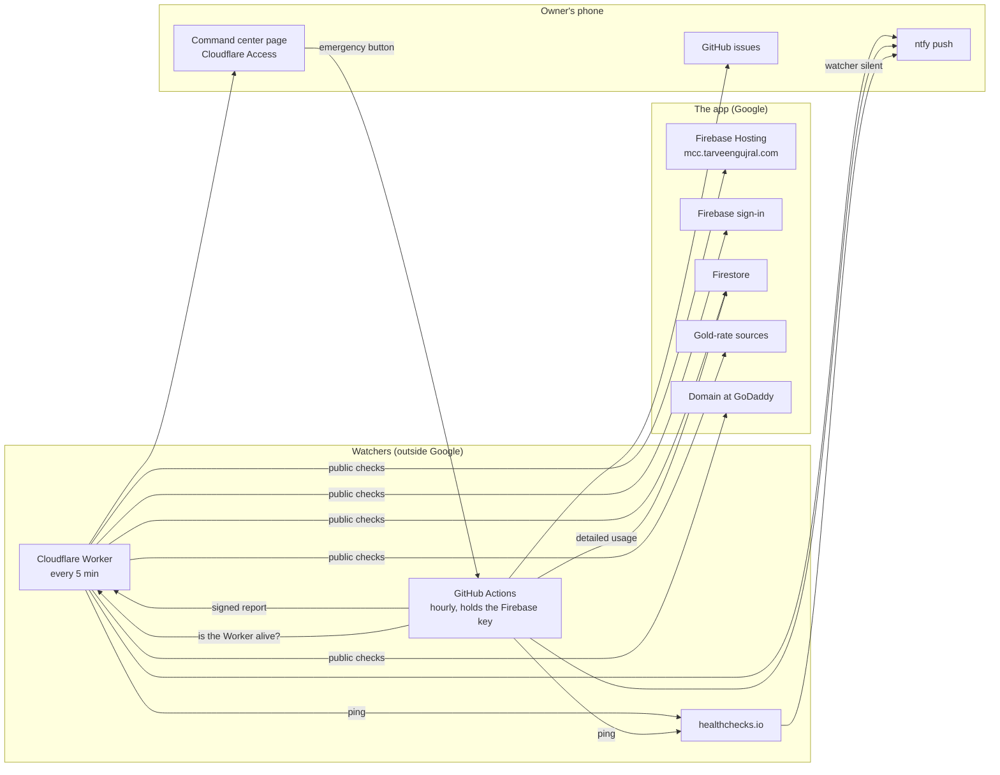

# Command center: build plan (Option B)

A small monitoring and emergency control room that runs **outside Firebase and Google**, so it keeps
working when the app, its database or its Admin tab can't. It costs $0. Only the owner can see it.

Visual overview: the "MCC Command Center" page Claude published for the owner (private link).

| Phase | What | State |
| --- | --- | --- |
| 0 | Safety net in the existing hourly monitor: ntfy push, dead-man's switch, certificate and domain checks, no names or IDs in public logs | **Built** (this folder's first PR) |
| 1 | Cloudflare Worker: checks every 5 minutes, history, private dashboard behind Cloudflare Access | Planned |
| 2 | Signed reports from GitHub, the two watchers checking each other, provider news, weekly digest | Planned |
| 3 | Emergency switches (rollback, light mode, banner, pause sign-ups, lockdown, check now) | Planned |
| 4 | No stored Google key (Workload Identity Federation), split permissions, outage rehearsal | Planned |

Every phase is a separate pull request with tests, merged only after the owner confirms.

---

## 1. Design rules

1. **Separate failure domains.** Viewing and alerting must not depend on Google. No single vendor
   (Google, GitHub, Cloudflare, ntfy) may be able to silence all alerts at once.
2. **Fail loud.** A watcher that misses its slot is an alert. Silence never means "fine".
3. **The Google key never leaves GitHub.** The Worker checks public endpoints and receives signed
   reports. It has no Google credentials.
4. **Emergency actions are pre-written, reviewed code** (GitHub workflows). There are no free-form commands.
   Every action is logged and announced by push.
5. **Public repo.** Nothing private goes into code, logs, issues or pushes. Secrets live only in GitHub
   secrets and Worker secrets.
6. **Stay free.** About 0 extra Firestore use, and small shares of every free tier. The command center
   watches its own usage.

## 2. Architecture

## 3. Components

### 3.1 Cloudflare Worker (`command-center/`, Phase 1)

- **Address:** `mcc-ops.<account>.workers.dev`. DNS stays at GoDaddy, because moving it would touch the live app.
- **Code:** plain JavaScript modules with no runtime npm dependencies. The page is under about 30 KB.
- **Scheduled runs** (Workers cron is in UTC):
  - every 5 minutes: probes, alert engine, push;
  - hourly: check that the GitHub report is fresh, prune old history;
  - Sunday 15:13 UTC: weekly digest.
- **Routes:**

  | Route | Who | Purpose |
  | --- | --- | --- |
  | `GET /` | Owner (Access) | The dashboard, rendered on the server from D1. Refreshes every 60 s. |
  | `GET /api/status` | Owner (Access), or GitHub with a signature | Current state as JSON |
  | `POST /api/report` | GitHub Actions (HMAC signature) | Hourly usage report and deploy results |
  | `GET /api/alive` | Anyone; returns only a timestamp | Lets GitHub check that the Worker's schedule is running |
  | `POST /api/action/:name` | Owner, freshly signed in (Phase 3) | Starts an emergency workflow |

- **Storage, D1** (free tier):
  - `runs(ts, results_json)`: one compact row per 5-minute run, kept 30 days (about 8,600 rows);
  - `state(key, level, since, text, last_push)`: the current alerts;
  - `reports(ts, json)`: the last 60 days of GitHub reports;
  - `actions(ts, action, result, who)`: audit log, kept 1 year.
- **Worker secrets:** `REPORT_KEY` (HMAC), `NTFY_TOPIC`, `NTFY_TOKEN` (optional), `HEALTHCHECK_URL` (a separate
  healthchecks.io check for the Worker), `ACCESS_TEAM`, `ACCESS_AUD`, and from Phase 3 `GH_DISPATCH_TOKEN`.
  `wrangler.toml` holds no secrets.

### 3.2 Probes (Phase 1)

Each probe has an 8-second timeout. A probe alerts only after **2 failures in a row**, which is about 10 minutes.

| Probe | Healthy when | Alert |
| --- | --- | --- |
| Home page `https://mcc.tarveengujral.com/` | 200, page looks like the app | App down |
| Live version (`/sw.js` `VERSION`) | Equals the version on `main` (from the last report) within 30 min of a deploy | Deploy didn't go live, or a stale cache |
| Old addresses (`making-charge.web.app`, GitHub Pages copy) | 200 | Forwarding broken |
| Sign-in handler `/__/auth/handler` | 200 | Google sign-in broken |
| Sign-in project settings (Identity Toolkit, public with the web API key) | Answers; the app's address is in the authorized domains | Sign-in misconfigured or down |
| Firestore endpoint (unauthenticated GET of a doc that doesn't exist) | 401/403/404 answer quickly | Database service down (5xx or timeout) |
| Firebase SDK on gstatic (`firebasejs/12.19.0`) | 200 | Sign-in code can't load; SDK version withdrawn |
| gold-api.com, currency-api (both mirrors), Frankfurter | Answer, with values inside `goldOk`/`fxOk` | Source down, or its format changed |
| DNS over HTTPS: the app's records and the domain's nameservers | Same as the baseline saved at setup | DNS changed (hijack or a mistake) |
| Provider status: Google Cloud, GitHub, Cloudflare (every 15 min) | No open incident for the products we use | Shown as context ("Google incident") rather than as a fault |

The certificate check stays in the GitHub monitor (Phase 0), because Workers can't read certificate
details. The domain-expiry check runs in both places, so each confirms the other.

### 3.3 Hourly GitHub monitor (exists; extended in Phase 2)

- It stays the only place that holds a Google credential.
- After each run it sends a **signed report** to `POST /api/report`:
  - `{ v, ts, usage, alerts, deploy: { sha, version, ok }, google }`, counts only;
  - header `X-MCC-Signature` = HMAC-SHA256(`REPORT_KEY`, `ts + "." + body`), plus `X-MCC-Timestamp`.
- **The Worker rejects** a report that:
  - is older than 5 minutes;
  - is not newer than the last one (replay);
  - is larger than 32 KB;
  - fails the schema check.
- It also checks `GET /api/alive`. If the Worker's last scheduled run is over 20 minutes old, it pushes a
  message and opens an issue.
- It reads the Worker's urgent alerts (`/api/status`, signed) and **mirrors them into GitHub issues**. That way
  Worker-found problems also reach the second channel without the Worker needing GitHub issue rights.

### 3.4 Alert engine and messages

- The levels are info, warning and urgent. Each signal has one state row.
- **Push only on change:**
  - a new alert;
  - an alert that got worse;
  - a warning or urgent alert that cleared.
  Several changes in one run become one push at the worst level's priority. This already exists in `scripts/monitor.mjs`.
- **ntfy priorities:**

  | Alert | Priority |
  | --- | --- |
  | Urgent | 5 |
  | Warning | 4 |
  | Info | 3 |
  | Back to normal | 2 |
- **A quiet period after a deploy** (10 minutes) avoids false alarms while phones update.
- **Every urgent alert has two paths:** ntfy, plus a GitHub issue (directly from Actions, or mirrored within the hour).
- **The weekly digest** covers:
  - 7-day usage against the limits, and the trend;
  - upcoming expiries;
  - provider news to read;
  - last week's alerts and actions;
  - the command center's own free-tier usage.

### 3.5 Provider news (Phase 2, weekly)

- **Sources:**
  - Firebase release notes;
  - the Firebase pricing page (a content hash, so any change is flagged "review");
  - the GitHub changelog;
  - Cloudflare Workers changelog;
  - releases of `fawazahmed0/exchange-api` and the gold-api docs page.
- **Filter keywords:** Spark, free, quota, limit, deprecat, shut down, sunset, pricing, `12.19`, Node, `actions/checkout`.
- **Unannounced changes are caught by how things behave:**
  - new error codes;
  - answers in a new shape;
  - `resource-exhausted` well below the known limits.
  Each becomes an alert saying "a provider changed something".
- **Hosting transfer** (360 MB/day) can't be read on the free plan: Google reports it only with billing on. At
  about 25 KB per fresh visit, reaching it would take thousands of fresh visits a day. The digest notes it as not measured.

### 3.6 Private dashboard (Phase 1)

- **Layout:**
  - one overall status (green, amber or red) with the reason;
  - a tile for each area: Up, Sign-in, Database, Rates, Address, Watchers;
  - today's usage meters with a projection ("reads run out around 7 pm");
  - 7-day sparklines;
  - provider incidents;
  - the expiry calendar;
  - recent alerts;
  - the audit log;
  - the emergency buttons (Phase 3).
- **Headers:**
  - `Content-Security-Policy: default-src 'none'`, with only hashed inline styles and scripts;
  - `X-Robots-Tag: noindex`;
  - `Cache-Control: no-store`;
  - `Referrer-Policy: no-referrer`.
- All data shown on the page is escaped (no HTML from inputs). It shows counts only.

### 3.7 Login: Cloudflare Access (Phase 1)

- **Zero Trust free plan, one application** covering the Worker's `workers.dev` address.
  - Policy: allow only the owner's email.
  - Login methods: one-time PIN by email, plus GitHub.
  - Session length: 24 hours.
- **Service paths** (`/api/report`, `/api/alive`) get a *Bypass* policy. They authenticate with HMAC, or return no data.
- **The Worker also verifies the Access JWT itself** (`Cf-Access-Jwt-Assertion`: RS256 against the team's
  keys, checking `aud` and `email`) on every owner route. If the Access settings ever drift, the page still refuses strangers.
- **Emergency actions need a fresh login** (JWT issued within the last 10 minutes). Otherwise the page sends you
  through the login again before the button works.

### 3.8 Emergency switches (Phase 3)

The flow for each button:

1. **The page:** you type a confirmation word, and the page sends a POST with a one-time token.
2. **The Worker checks:**
   - a fresh login;
   - the confirmation;
   - at most one action a minute and 10 a day.
3. **The Worker logs and announces it:** it records the action and pushes "Action started: …".
4. **The Worker starts the workflow** (`emergency.yml`) through GitHub's `workflow_dispatch` API, using a
   **fine-grained token** that can only run workflows in this one repo and has an expiry date (itself watched).
5. **The workflow reports back:** it runs the action and reports the result to the Worker. You get a push such as "Rollback done".

Optional extra safety: the workflow runs in a GitHub *environment* that needs your approval in the GitHub app.

| Action | How | Undo |
| --- | --- | --- |
| Roll back | Redeploy the commit tagged `last-good` (the deploy workflow moves the tag after the post-deploy check passes) | Deploy `main` again |
| Light mode | `config/app.mode = 'light'`: the app stops loading photos; rules deny photo reads in that mode | `mode = 'normal'` |
| Read-only | `config/app.mode = 'readonly'`: rules deny writes to `users/**` | `mode = 'normal'` |
| Maintenance banner | `config/app.banner` = one of a few preset messages, shown to signed-in people | `banner = null` |
| Pause sign-ups | `config/app.signups = false`: rules deny creating `requests/*` | `signups = true` |
| Lockdown | Deploy `firebase/firestore.lockdown.rules` (owner only) | Normal deploy |
| Check now | Start the Monitor workflow | Nothing to undo |

- The flags reuse `config/app`, which the app already reads, so they add **no extra reads**.
- Phase 3 changes `docs/` and the rules, so it follows CLAUDE.md:
  - VERSION bump in both files;
  - rules tests for every flag;
  - an e2e test for the banner and light mode;
  - the lockdown rules file keeps the `PASTE-YOUR-UID-HERE` placeholder exactly once.

### 3.9 Credentials and permissions (Phase 4)

- **Today:** one stored key with *Firebase Admin* does both the deploys and the monitoring.
- **Target:** GitHub's short-lived login to Google (OIDC → Workload Identity Federation), so no stored key exists:
  - **deploy identity:** Hosting Admin and Rules Admin, only from `deploy.yml` on `main`;
  - **monitor identity:** Datastore User and Monitoring Viewer, only from `monitor.yml` and `emergency.yml`.
- The token exchange is done with Node built-ins, like the rest of the monitor. `firebase-tools` accepts the
  resulting credential file, which holds no secret.
- After that: delete the old key and the `FIREBASE_SERVICE_ACCOUNT` secret.

## 4. Security review

| Threat | Mitigation |
| --- | --- |
| Someone learns the ntfy topic | Long random name kept as a secret; pushes hold counts only; a fake push can't trigger anything; rotate the topic in 2 minutes |
| Report key leaks | It can only post usage numbers, which are schema-checked and range-checked. It can't read data or start actions. Rotate both copies. |
| Dashboard reached by a stranger | Access (email allow-list) plus the Worker's own JWT check |
| Clicked by mistake, or CSRF | POST only, a custom header, a one-time token, a typed confirmation, a fresh login |
| GitHub dispatch token leaks | Can only start the pre-written workflows in this repo; expires; every run pushes a notice |
| Cloudflare, GitHub, GoDaddy or Google account taken over | 2-step login or passkeys on all four (owner checklist); DNS-change and nameserver probes; domain lock at GoDaddy |
| A bad Worker release | Tests in `npm test`; the hourly monitor alerts if the Worker goes silent; `wrangler rollback` |
| Supply chain | No runtime dependencies in the Worker; `wrangler` pinned to an exact version in the deploy workflow |
| Public logs | `scrub()` removes user IDs and emails from anything logged, pushed or posted |

## 5. Free-tier budget (normal day)

| Service | Use | Free amount |
| --- | --- | --- |
| Worker requests | ~350 (288 scheduled + page views + 24 reports) | 100,000/day |
| Worker outbound requests per run | ~15 | 50 |
| D1 rows written | ~320 | 100,000/day |
| D1 storage | < 20 MB | 5 GB |
| Firestore | ~0 from the Worker (up to 288 reads if Google counts denied requests); unchanged from GitHub | 50,000 reads/day |
| ntfy messages | a handful | a few hundred/day |
| healthchecks.io | 2 checks (monitor, Worker) | 20 checks |
| GitHub Actions | ~25 minutes/day | Free for public repos |
| Cloudflare Access | 1 user | 50 users |

## 6. Outage behaviour

| What breaks | Still works | You're told by | You do |
| --- | --- | --- | --- |
| Firebase/Google | Offline calculator; command center | Worker (2 failed checks) + Google status | Wait; push on recovery |
| Free daily limit | Calculator, rates | Projection warning, then urgent | Light mode until midnight Pacific |
| GitHub | App; Worker checks | Worker: report out of date for over 90 min; healthchecks.io | Buttons wait for GitHub |
| Cloudflare | App; hourly monitor | Monitor: `/api/alive` silent; healthchecks.io; GitHub issue | GitHub run summary as a fallback view |
| ntfy | Everything else | GitHub issues; healthchecks.io email | Nothing |
| Rate source | App fallbacks | Worker per-source probe | Change the source order if it's gone for good |
| Bad deploy | Old version on phones | Version or error checks after the deploy | Roll back |
| Domain or certificate expiring | Everything until the date | Monitor (built in Phase 0) | Renew; keep auto-renew on |

## 7. Phases, the owner's steps and "done when"

### Phase 0: built
- **Owner:**
  1. Install the ntfy app.
  2. Create the `NTFY_TOPIC` secret.
  3. Create a healthchecks.io check (period 1 h, grace 1 h, with email and ntfy integrations) and the `HEALTHCHECK_URL` secret.
  4. At GoDaddy: turn on auto-renew, domain lock and 2-step login.
- **Done when:** a manual Monitor run turns the healthchecks.io check green, and a test alert reaches the phone.

### Phase 1: Worker, probes, dashboard
- **Owner:**
  1. Create a free Cloudflare account (2-step login on).
  2. Allow your email in Zero Trust → Access.
  3. Create an API token limited to *Workers Scripts: Edit* and *D1: Edit* for that account, and save it as the GitHub
     secrets `CLOUDFLARE_API_TOKEN` and `CLOUDFLARE_ACCOUNT_ID`.
  4. Create a second healthchecks.io check (period 5 min, grace 10 min).
- **Claude:**
  - the `command-center/src/*` code;
  - `schema.sql` and `wrangler.toml`;
  - `.github/workflows/command-center.yml` (deploys on changes under `command-center/`);
  - `npm run test:cc`, added to `npm test`;
  - a CLAUDE.md section for the folder.
- **Done when:**
  - stopping a probe target in a test makes one push after 2 failures and one "back to normal";
  - the page refuses a request without a valid Access JWT;
  - the page loads in under 1 s on a phone.

### Phase 2: cross-checking, news, digest
- **Owner:** save the `MCC_REPORT_KEY` secret in both GitHub and the Worker (Claude generates it locally, and it is never committed).
- **Done when:**
  - a stopped Worker schedule is reported by GitHub within 2 hours;
  - a stopped GitHub schedule is reported by the Worker within 90 minutes;
  - the digest arrives on Sunday.

### Phase 3: emergency switches
- **Owner:** create the fine-grained token (Actions: read and write, this repo only, 1-year expiry), and save it as a Worker secret.
- **Done when:** each action and its undo pass in tests (rules plus e2e), and a real rollback rehearsal on the live app
  takes under 5 minutes from button to "done" push.

### Phase 4: no stored key, rehearsal
- **Owner:** a few clicks in Google Cloud to allow GitHub's login (Claude gives the exact steps), then delete the old key.
- **Done when:**
  - deploys and the monitor run without `FIREBASE_SERVICE_ACCOUNT`;
  - each row of section 6 has been simulated once, and the alert arrived.

## 8. To confirm while building

These assumptions are checked at the start of the phase that needs them, and the plan is adjusted if any proves wrong:
- Cloudflare Access can protect the `workers.dev` address, with a path-level bypass for `/api/report` and `/api/alive` (Phase 1).
- Identity Toolkit's public project-settings endpoint gives the authorized domains with only the web API key (Phase 1).
- Whether Firestore counts unauthenticated, denied requests as reads. If it does, that probe moves to every 15 minutes (Phase 1).
- The exact free limits of Workers cron triggers, D1, ntfy.sh and healthchecks.io at build time (each phase).
- Workload Identity Federation works on a project without billing (Phase 4).
